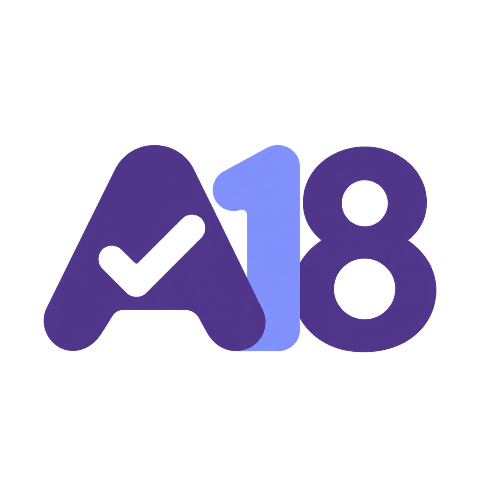
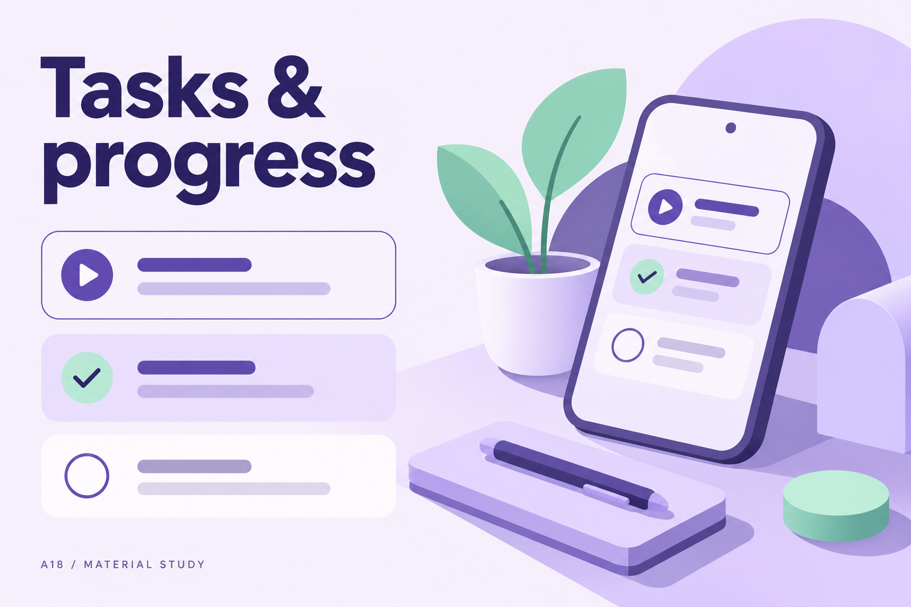
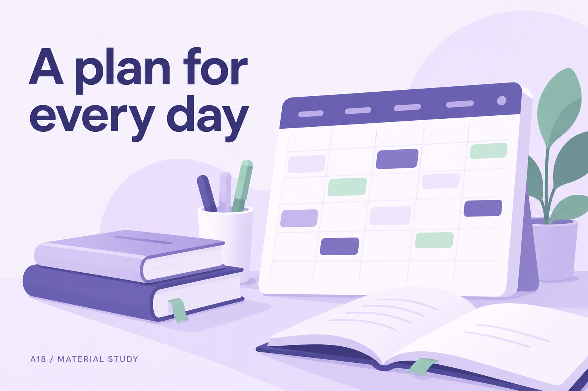
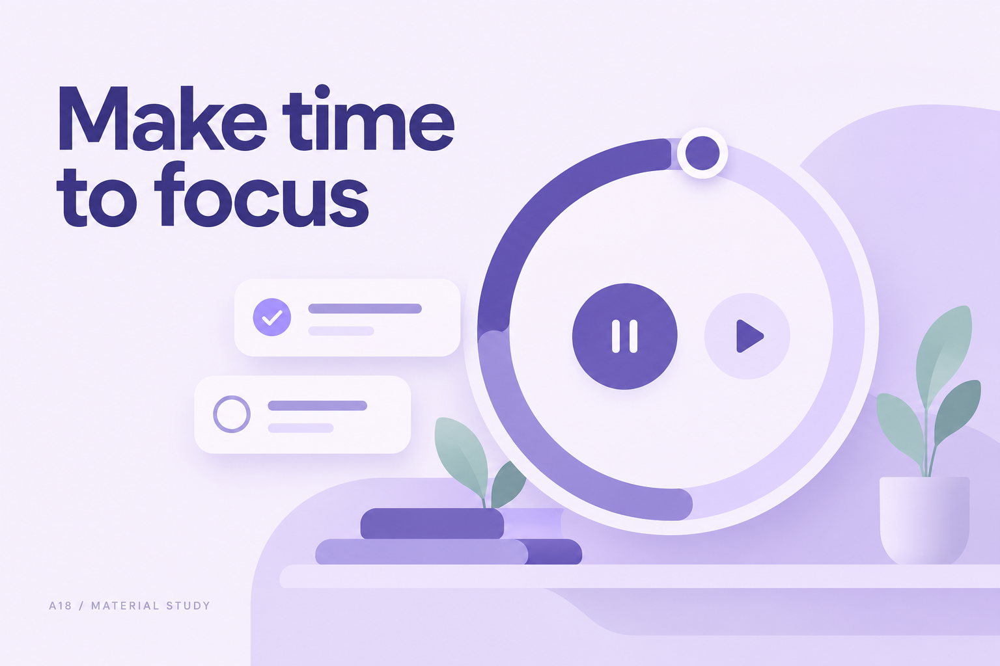
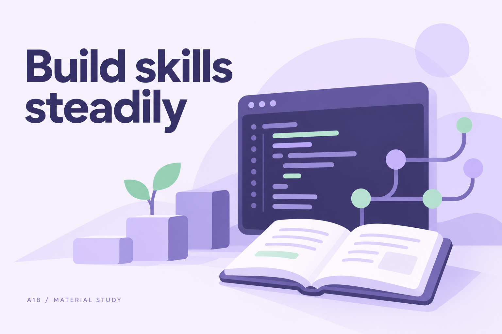
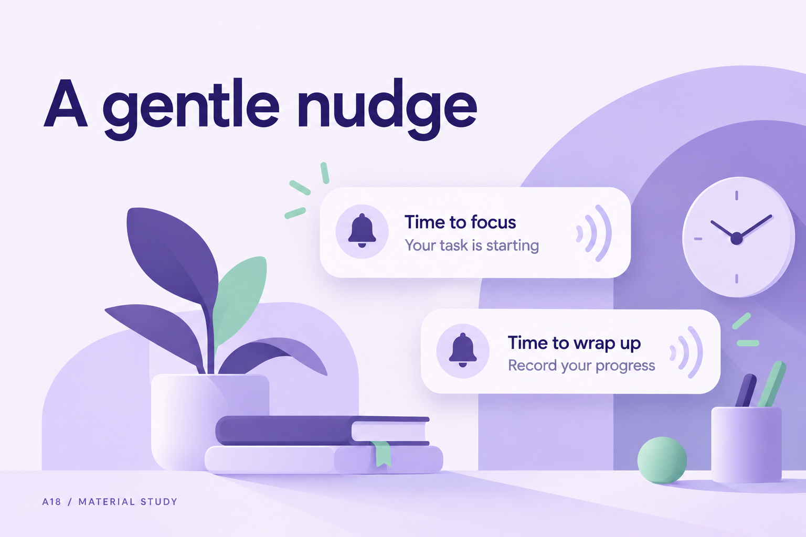
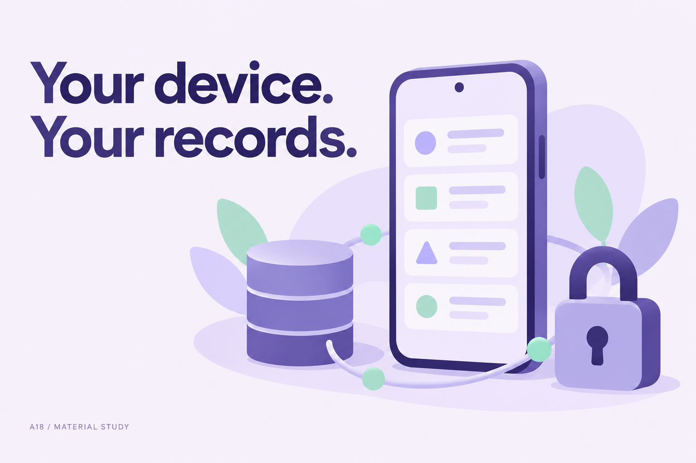
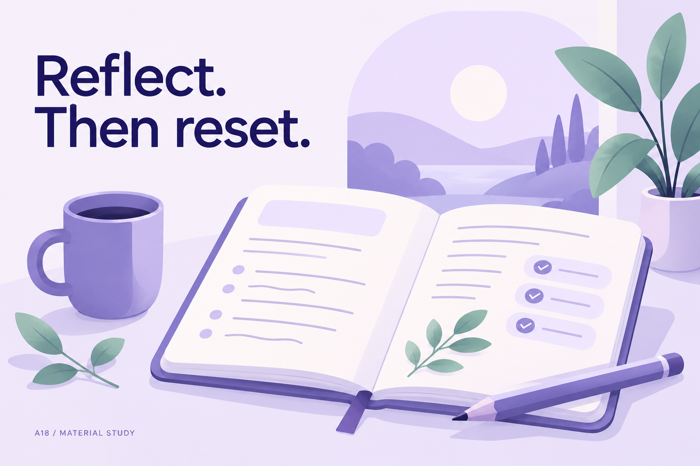

<div align="center">



# A18 Discipline OS

**A personal space for tasks, focus, and honest progress.**

Native Android · Material 3 · Local-first · No account required

[Download APK](releases/A18-Discipline-OS.apk?raw=true) · [Build the app](docs/DEVELOPMENT.md) · [Architecture](docs/ARCHITECTURE.md) · [Verification](docs/VERIFICATION.md)



</div>

## Start with today

A18 brings your daily to-do list, academic routine, coding practice, focus timer,
activity logs, and reflection into one native Android app. Open it, see today's
tasks, and record what actually happened. Progress comes from your saved actions.

The interface follows Material Design 3: system light/dark appearance, dynamic
colors on Android 12+, tonal surfaces, rounded shapes, and native navigation.
The A18 logo is an original identity inspired by Material geometry.

## A little more room for your day

The artwork below introduces A18's main features. These are **concept illustrations,
not screenshots**; they contain no personal records or measured productivity data.
The app follows Android's system appearance and dynamic colors.

<table>
<tr>
<td width="50%"><br /><strong>A plan for every day</strong><br />An editable timetable and four months of predefined tasks.</td>
<td width="50%"><br /><strong>Make time to focus</strong><br />Custom focus sessions, breaks and task-linked logging.</td>
</tr>
<tr>
<td><br /><strong>Build skills steadily</strong><br />Keep academic revision and coding practice together.</td>
<td><br /><strong>A gentle nudge</strong><br />Separate task-start and task-end notifications and sounds.</td>
</tr>
<tr>
<td><br /><strong>Your device. Your records.</strong><br />Local storage, optional encrypted backups and no account.</td>
<td><br /><strong>Reflect. Then reset.</strong><br />Review unfinished work and plan your next step honestly.</td>
</tr>
</table>

Eight PNG assets: the original A18 logo and seven matching feature illustrations.
See [artwork details](docs/README-ASSETS.md).

## What you can do

| Plan | Focus | Understand |
| :--- | :--- | :--- |
| Tasks, subtasks, priorities and deadlines | Custom focus intervals and task links | Activity-based analytics |
| Editable college timetable and study planner | Starting and ending task notifications | Gaming and distraction logs |
| Coding, project and personal goals | Pause/resume with saved timer state | Daily reflection and challenge streaks |
| Four-month predefined evening plan | Separate custom start/end sounds | Honest completion and missed-task history |

The task manager supports Completed, Missed, Skipped and Postponed outcomes.
Archived responsibilities stay in **Previous plan**, preserving notes and history.
The optional private space and encrypted journals are excluded from ordinary exports.

## Install

**Current build: 1.0.6 · debug APK · Android 8.0 or newer.**

1. [Download A18-Discipline-OS.apk](releases/A18-Discipline-OS.apk?raw=true).
2. Open the file on your Android phone and allow installation from your chosen file app.
3. Launch A18. The branded loading screen opens the **To-do list** when local records are ready.
4. Allow notifications if you want task reminders. Android's **Alarms & reminders**
   access enables precise notification scheduling; the app does not show alarm-clock screens.

The included APK is debug-signed for personal testing. Its SHA-256 is recorded in
[the checksum file](releases/A18-Discipline-OS.apk.sha256). Updates must use the same
signing key to preserve the installation. Export a backup before changing keys;
do not uninstall just to apply a normal same-key update.

```powershell
$expected = (Get-Content .\releases\A18-Discipline-OS.apk.sha256).Split(' ')[0]
$actual = (Get-FileHash .\releases\A18-Discipline-OS.apk -Algorithm SHA256).Hash
if ($actual -ne $expected) { throw 'APK checksum mismatch' }
```

## The predefined plan

**19 October 2026 to 18 February 2027 · 123 dates · 856 tasks.**

19 October contains assignments from 20:00 to 21:45 and GitHub work from 21:45
to 23:00, with additional check-ins at 21:40 and 22:55. Each subsequent date has:

| Time | Responsibility |
| :--- | :--- |
| 19:00–19:45 | Daily Subject Study |
| 19:45–20:30 | College Assignments |
| 20:30–20:50 | Dinner & Break |
| 20:50–21:35 | GitHub / Coding Practice |
| 21:35–22:05 | Gaming & Entertainment |
| 22:05–22:30 | Revision & Pending Tasks |
| 22:30–23:00 | Daily Review & Self-Control |

Topics progress through academic revision, Git, CI/CD and AI/ML practice. Every
date and task remains editable. These are seeded plans, not completed work or
an official college syllabus. The 30-day challenge starts on 19 October 2026.

## Your device, your records

- Room stores tasks, history and logs; DataStore stores settings and notification scheduling state.
- The installed app has no Internet permission, server, login or cloud dependency.
- Android Keystore-backed encryption protects private records and journals.
- The app blocks screenshots and recent-app previews. No fabricated screenshots are included here.
- Ordinary JSON backups exclude sensitive records. Sensitive transfer needs explicit consent and encrypted export.
- Clearing app storage, uninstalling or losing the encryption key can erase records. Keep manual backups.
- Laptop and phone data are separate. Local storage does not synchronize devices.

This repository contains source code, unused predefined plans, documentation and
the compiled APK. It does **not** contain device databases, journals, habit records,
backup exports, credentials, signing keys or previous development history.

## Build and test

Open this folder in Android Studio. Install SDK Platform 35 and Build Tools 35.0.0,
select JDK 17 or 21, and let Android Studio create your local SDK configuration.
The first dependency download needs Internet on the development computer.

```powershell
.\gradlew.bat :app:testDebugUnitTest :app:lintDebug :app:assembleDebug
```

Use a **disposable emulator with no personal records** for connected tests.
The default test-runner cleanup uninstalls the app and erases local data:

```powershell
.\gradlew.bat :app:connectedDebugAndroidTest
```

Source builds generate their own debug signing key. They may not update the
included APK's installation unless the same original key is used. No private
signing key is distributed. For signed personal releases, see [development instructions](docs/DEVELOPMENT.md).

## Stack

Kotlin · Jetpack Compose · Material 3 · Room · DataStore · Coroutines · StateFlow ·
Android Keystore · AlarmManager · WorkManager

```text
app/                 Native application, bundled plans and automated tests
assets/              README artwork and original A18 logo
docs/                Build, architecture, verification and publishing guides
gradle/              Gradle wrapper
releases/            Installable debug APK and SHA-256 checksum
tools/               Local public-package verification
```

The main application sources and APK match the tested 1.0.6 build. Bundled plan
assets are self-contained; building does not require the separate website or Node.js.
See [verification](docs/VERIFICATION.md) for tested behavior and limits. Notification
sound respects Silent/DND/channel settings; Android can delay closely spaced
alerts in deep idle or play one sound for simultaneous transitions.

## Publishing and attribution

Use [the 12 manual command batches](docs/MANUAL-PUBLISH.md) to initialize Git,
review the package, create your own public GitHub repository and push each batch yourself. The final batch also creates a GitHub pre-release with the APK and checksum.
The public project is hosted at [mhatreanuj57-alt/A18-Discipline-OS](https://github.com/mhatreanuj57-alt/A18-Discipline-OS).

Project-wide licensing has not been selected. Google Material icon resources
retain their [Apache 2.0 license](docs/MATERIAL_ICONS_LICENSE.txt). The original
logo's generation prompt is documented in [LOGO.md](docs/LOGO.md). Custom audio
was supplied by the project owner. A18 is not affiliated with Google.
